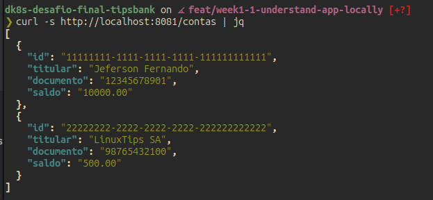
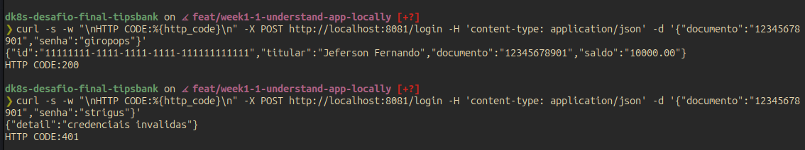
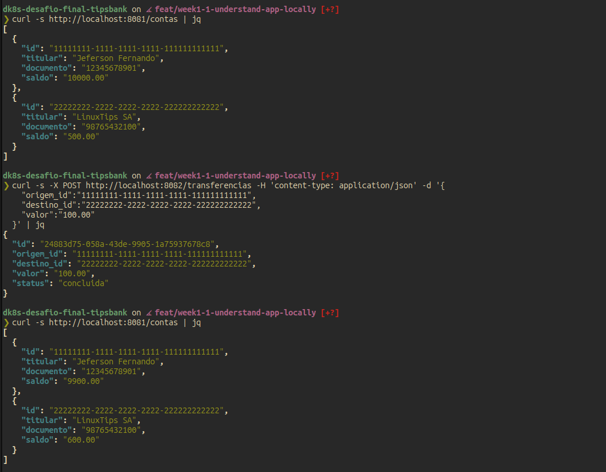

# SEMANA 1 — Fundações

> **Objetivo da semana**: subir um cluster kubeadm funcional, conteinerizar a app em imagens Distroless (e nonroot no caso do `web`) assinadas com Cosign, e ter os **4 serviços** (3 APIs + frontend) rodando como workloads básicos com ConfigMap, Secret e Volume.

---

## Etapa 1.1 - Entender a aplicação localmente

**Evidências**:

- `curl http://localhost:8081/contas` retorna as 2 contas seed (sem campo `senha_hash` exposto)

  

- Login bate 200 com senha certa e 401 com errada:
  

- Uma transferência de R$ 100 muda o saldo de ambas as contas

  

- O arquivo `/data/eventos-YYYY-MM-DD.jsonl` dentro do container `auditoria` tem uma linha por transferência
  
  

- SPA em `localhost:8080` funciona ponta a ponta (abrir, logar, transferir, ver extrato)

  

---

## Etapa 1.2 — Build Distroless, scan com Trivy, assinatura Cosign

**Pergunta**: Por que a utilização de **multi-stage build** e imagens **distroless** diminui a existência de vulnerabilidades ?
**Resposta**:
A utilização de **multi-stage build** permite que uma imagem seja criada utilizando uma ou mais imagens intermediárias antes da criação de uma imagem final contendo a aplicação que será executada. Está técnica permite que a imagem final contenha somente o mínimo necessário para a aplicação executar, fazendo assim com que a imagem resultante tenha um tamanho reduzido (em comparação com a original). Já a utilização de imagens **distroless** são projetadas para conterem o mínimo possível para execução de uma aplicação. Existem imagens **distroless** fornecidas por empresas especializadas e livres de vulnerabilidades de segurança conhecidas. Com a utilização das duas técnicas, reduz-se o tamanho da imagem e a superfície de ataque pois a imagem contém somente código/binários minimamente necessários para execução da aplicação.

**Evidências**:

- `trivy image` devolve **0 vulnerabilidades HIGH ou CRITICAL** nas 4 imagens
- `cosign verify` passa nas 4 imagens
- `docker inspect` mostra que o usuário final é não-root (UID 65532 nas 3 APIs, UID 101 no `web`)
- Tamanho final das imagens Python < 150 MB; `web` (nginx) < 30 MB