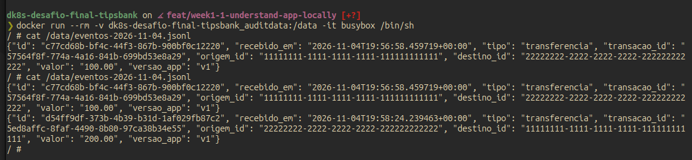
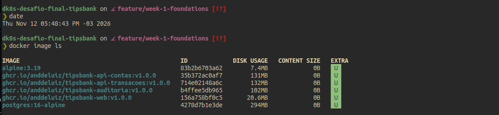
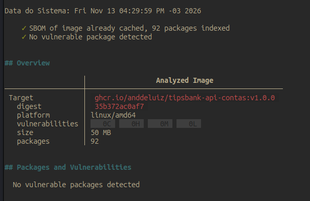
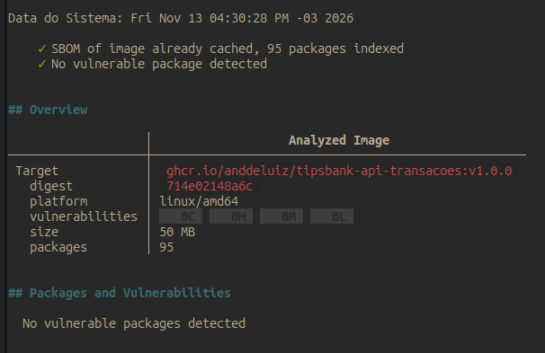
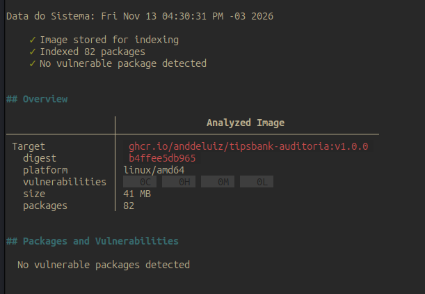
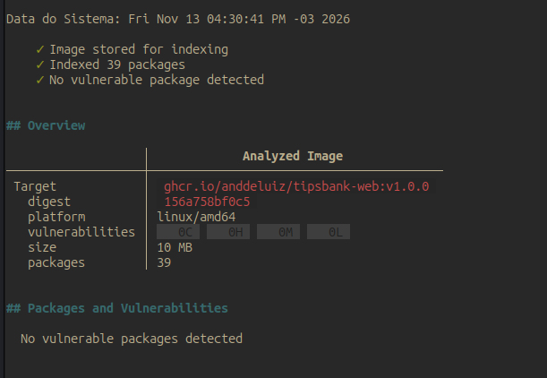
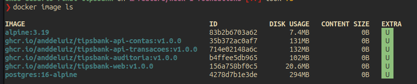

# SEMANA 1 — Fundações

> **Objetivo da semana**: subir um cluster kubeadm funcional, conteinerizar a app em imagens Distroless (e nonroot no caso do `web`) assinadas com Cosign, e ter os **4 serviços** (3 APIs + frontend) rodando como workloads básicos com ConfigMap, Secret e Volume.

---

## Etapa 1.1 - Entender a aplicação localmente

**Evidências**:

- `curl http://localhost:8081/contas` retorna as 2 contas seed (sem campo `senha_hash` exposto)

  

- Login bate 200 com senha certa e 401 com errada:
  


- Uma transferência de R$ 100 muda o saldo de ambas as contas

  

- O arquivo `/data/eventos-YYYY-MM-DD.jsonl` dentro do container `auditoria` tem uma linha por transferência
  
  

- SPA em `localhost:8080` funciona ponta a ponta (abrir, logar, transferir, ver extrato)

  

---

## Etapa 1.2 — Build Distroless, scan com Trivy, assinatura Cosign

**Pergunta**: Por que a utilização de **multi-stage build** e imagens **distroless** diminui a existência de vulnerabilidades ?
**Resposta**:
A utilização de **multi-stage build** permite que uma imagem seja criada utilizando uma ou mais imagens intermediárias antes da criação de uma imagem final contendo a aplicação que será executada. Está técnica permite que a imagem final contenha somente o mínimo necessário para a aplicação executar, fazendo assim com que a imagem resultante tenha um tamanho reduzido (em comparação com a original). Já a utilização de imagens **distroless** são projetadas para conterem o mínimo possível para execução de uma aplicação. Existem imagens **distroless** fornecidas por empresas especializadas e livres de vulnerabilidades de segurança conhecidas. Com a utilização das duas técnicas, reduz-se o tamanho da imagem e a superfície de ataque pois a imagem contém somente código/binários minimamente necessários para execução da aplicação.


**Evidências**:

- `docer image ls` devolve imagens menores que 150MB para as 4 imagens de aplicações do tipsbank.

   

- `trivy image` devolve **0 vulnerabilidades HIGH ou CRITICAL** nas 4 imagens.

  A varredura das imagens foi executada em 2026-11-13. Segue a saída do comando `trivy version`:

  ```text
  Version: 0.76.2
  Vulnerability DB:
    Version: 2
    UpdatedAt: 2026-11-12 18:57:38.498853214 +0000 UTC
    NextUpdate: 2026-11-13 18:57:38.498852944 +0000 UTC
    DownloadedAt: 2026-11-12 21:12:54.665674989 +0000 UTC
  Check Bundle:
    Digest: sha256:1583562f8b90ed2a071b99f0e5ffff6b57e4ceb6ca3e4796577b4e6a339eb74c
    DownloadedAt: 2026-06-11 20:05:49.667805819 +0000 UTC
  ```

  As evidências das varreduras das imagens foi coletada em dois formatos: texto e JSON. O formato texto será exposto neste documento e mantido o registro em arquivo. O formato JSON está disponível para maior detalhamento.

  - **Imagem**: ghcr.io/anddeluiz/tipsbank-api-contas:v1.0.0
    - **JSON**: [trivy-image-tipsbank-api-contas-v1.0.0.json](./etapa-1.2/trivy-image-tipsbank-api-contas-v1.0.0.json)
    - **Texto**: [trivy-image-tipsbank-api-contas-v1.0.0.txt](./etapa-1.2/trivy-image-tipsbank-api-contas-v1.0.0.txt)

    ```text
    2026-11-13T14:59:46-03:00	INFO	[vuln] Vulnerability scanning is enabled
    2026-11-13T14:59:46-03:00	INFO	[secret] Secret scanning is enabled
    2026-11-13T14:59:46-03:00	INFO	[secret] If your scanning is slow, please try '--scanners vuln' to disable secret scanning
    2026-11-13T14:59:46-03:00	INFO	[secret] Please see https://trivy.dev/docs/v0.76/guide/scanner/secret#recommendation for faster secret detection
    2026-11-13T14:59:46-03:00	INFO	Detected OS	family="wolfi" version="20230201"
    2026-11-13T14:59:46-03:00	INFO	[wolfi] Detecting vulnerabilities...	pkg_num=30
    2026-11-13T14:59:46-03:00	INFO	Number of language-specific files	num=1
    2026-11-13T14:59:46-03:00	INFO	[python-pkg] Detecting vulnerabilities...

    Report Summary

    ┌───────────────────────────────────────────────────────────────┬────────────┬─────────────────┬─────────┐
    │                            Target                             │    Type    │ Vulnerabilities │ Secrets │
    ├───────────────────────────────────────────────────────────────┼────────────┼─────────────────┼─────────┤
    │ ghcr.io/anddeluiz/tipsbank-api-contas:v1.0.0 (wolfi 20230201) │   wolfi    │        0        │    -    │
    ├───────────────────────────────────────────────────────────────┼────────────┼─────────────────┼─────────┤
    │ packages/SQLAlchemy-2.0.35.dist-info/METADATA                 │ python-pkg │        0        │    -    │
    ├───────────────────────────────────────────────────────────────┼────────────┼─────────────────┼─────────┤
    │ packages/annotated_doc-0.0.6.dist-info/METADATA               │ python-pkg │        0        │    -    │
    ├───────────────────────────────────────────────────────────────┼────────────┼─────────────────┼─────────┤
    │ packages/annotated_types-0.8.0.dist-info/METADATA             │ python-pkg │        0        │    -    │
    ├───────────────────────────────────────────────────────────────┼────────────┼─────────────────┼─────────┤
    │ packages/anyio-4.16.0.dist-info/METADATA                      │ python-pkg │        0        │    -    │
    ├───────────────────────────────────────────────────────────────┼────────────┼─────────────────┼─────────┤
    │ packages/bcrypt-4.2.0.dist-info/METADATA                      │ python-pkg │        0        │    -    │
    ├───────────────────────────────────────────────────────────────┼────────────┼─────────────────┼─────────┤
    │ packages/click-8.5.1.dist-info/METADATA                       │ python-pkg │        0        │    -    │
    ├───────────────────────────────────────────────────────────────┼────────────┼─────────────────┼─────────┤
    │ packages/fastapi-0.137.2.dist-info/METADATA                   │ python-pkg │        0        │    -    │
    ├───────────────────────────────────────────────────────────────┼────────────┼─────────────────┼─────────┤
    │ packages/h11-0.16.0.dist-info/METADATA                        │ python-pkg │        0        │    -    │
    ├───────────────────────────────────────────────────────────────┼────────────┼─────────────────┼─────────┤
    │ packages/httptools-0.9.0.dist-info/METADATA                   │ python-pkg │        0        │    -    │
    ├───────────────────────────────────────────────────────────────┼────────────┼─────────────────┼─────────┤
    │ packages/idna-3.20.dist-info/METADATA                         │ python-pkg │        0        │    -    │
    ├───────────────────────────────────────────────────────────────┼────────────┼─────────────────┼─────────┤
    │ packages/prometheus_client-0.20.0.dist-info/METADATA          │ python-pkg │        0        │    -    │
    ├───────────────────────────────────────────────────────────────┼────────────┼─────────────────┼─────────┤
    │ packages/psycopg-3.3.8.dist-info/METADATA                     │ python-pkg │        0        │    -    │
    ├───────────────────────────────────────────────────────────────┼────────────┼─────────────────┼─────────┤
    │ packages/psycopg_binary-3.3.8.dist-info/METADATA              │ python-pkg │        0        │    -    │
    ├───────────────────────────────────────────────────────────────┼────────────┼─────────────────┼─────────┤
    │ packages/pydantic-2.14.3.dist-info/METADATA                   │ python-pkg │        0        │    -    │
    ├───────────────────────────────────────────────────────────────┼────────────┼─────────────────┼─────────┤
    │ packages/pydantic_core-2.50.4.dist-info/METADATA              │ python-pkg │        0        │    -    │
    ├───────────────────────────────────────────────────────────────┼────────────┼─────────────────┼─────────┤
    │ packages/python_dotenv-1.2.4.dist-info/METADATA               │ python-pkg │        0        │    -    │
    ├───────────────────────────────────────────────────────────────┼────────────┼─────────────────┼─────────┤
    │ packages/pyyaml-6.0.3.dist-info/METADATA                      │ python-pkg │        0        │    -    │
    ├───────────────────────────────────────────────────────────────┼────────────┼─────────────────┼─────────┤
    │ packages/starlette-1.3.1.dist-info/METADATA                   │ python-pkg │        0        │    -    │
    ├───────────────────────────────────────────────────────────────┼────────────┼─────────────────┼─────────┤
    │ packages/typing_extensions-4.16.0.dist-info/METADATA          │ python-pkg │        0        │    -    │
    ├───────────────────────────────────────────────────────────────┼────────────┼─────────────────┼─────────┤
    │ packages/typing_inspection-0.4.5.dist-info/METADATA           │ python-pkg │        0        │    -    │
    ├───────────────────────────────────────────────────────────────┼────────────┼─────────────────┼─────────┤
    │ packages/uvicorn-0.30.6.dist-info/METADATA                    │ python-pkg │        0        │    -    │
    ├───────────────────────────────────────────────────────────────┼────────────┼─────────────────┼─────────┤
    │ packages/uvloop-0.23.0.dist-info/METADATA                     │ python-pkg │        0        │    -    │
    ├───────────────────────────────────────────────────────────────┼────────────┼─────────────────┼─────────┤
    │ packages/watchfiles-1.3.0.dist-info/METADATA                  │ python-pkg │        0        │    -    │
    ├───────────────────────────────────────────────────────────────┼────────────┼─────────────────┼─────────┤
    │ packages/websockets-17.4.dist-info/METADATA                   │ python-pkg │        0        │    -    │
    └───────────────────────────────────────────────────────────────┴────────────┴─────────────────┴─────────┘
    Legend:
    - '-': Not scanned
    - '0': Clean (no security findings detected)

    ```

  - **Imagem**: ghcr.io/anddeluiz/tipsbank-api-transacoes:v1.0.0
    - **JSON**: [tipsbank-api-transacoes:v1.0.0.json](./etapa-1.2/trivy-image-tipsbank-api-transacoes-v1.0.0.json)
    - **Texto**: [tipsbank-api-transacoes:v1.0.0.txt](./etapa-1.2/trivy-image-tipsbank-api-transacoes-v1.0.0.txt)

    ```text
    2026-11-13T14:59:47-03:00	INFO	[vuln] Vulnerability scanning is enabled
    2026-11-13T14:59:47-03:00	INFO	[secret] Secret scanning is enabled
    2026-11-13T14:59:47-03:00	INFO	[secret] If your scanning is slow, please try '--scanners vuln' to disable secret scanning
    2026-11-13T14:59:47-03:00	INFO	[secret] Please see https://trivy.dev/docs/v0.76/guide/scanner/secret#recommendation for faster secret detection
    2026-11-13T14:59:47-03:00	INFO	Detected OS	family="wolfi" version="20230201"
    2026-11-13T14:59:47-03:00	INFO	[wolfi] Detecting vulnerabilities...	pkg_num=30
    2026-11-13T14:59:47-03:00	INFO	Number of language-specific files	num=1
    2026-11-13T14:59:47-03:00	INFO	[python-pkg] Detecting vulnerabilities...

    Report Summary

    ┌───────────────────────────────────────────────────────────────────┬────────────┬─────────────────┬─────────┐
    │                              Target                               │    Type    │ Vulnerabilities │ Secrets │
    ├───────────────────────────────────────────────────────────────────┼────────────┼─────────────────┼─────────┤
    │ ghcr.io/anddeluiz/tipsbank-api-transacoes:v1.0.0 (wolfi 20230201) │   wolfi    │        0        │    -    │
    ├───────────────────────────────────────────────────────────────────┼────────────┼─────────────────┼─────────┤
    │ packages/SQLAlchemy-2.0.35.dist-info/METADATA                     │ python-pkg │        0        │    -    │
    ├───────────────────────────────────────────────────────────────────┼────────────┼─────────────────┼─────────┤
    │ packages/annotated_doc-0.0.6.dist-info/METADATA                   │ python-pkg │        0        │    -    │
    ├───────────────────────────────────────────────────────────────────┼────────────┼─────────────────┼─────────┤
    │ packages/annotated_types-0.8.0.dist-info/METADATA                 │ python-pkg │        0        │    -    │
    ├───────────────────────────────────────────────────────────────────┼────────────┼─────────────────┼─────────┤
    │ packages/anyio-4.16.0.dist-info/METADATA                          │ python-pkg │        0        │    -    │
    ├───────────────────────────────────────────────────────────────────┼────────────┼─────────────────┼─────────┤
    │ packages/certifi-2026.10.23.dist-info/METADATA                    │ python-pkg │        0        │    -    │
    ├───────────────────────────────────────────────────────────────────┼────────────┼─────────────────┼─────────┤
    │ packages/click-8.5.1.dist-info/METADATA                           │ python-pkg │        0        │    -    │
    ├───────────────────────────────────────────────────────────────────┼────────────┼─────────────────┼─────────┤
    │ packages/fastapi-0.137.2.dist-info/METADATA                       │ python-pkg │        0        │    -    │
    ├───────────────────────────────────────────────────────────────────┼────────────┼─────────────────┼─────────┤
    │ packages/h11-0.16.0.dist-info/METADATA                            │ python-pkg │        0        │    -    │
    ├───────────────────────────────────────────────────────────────────┼────────────┼─────────────────┼─────────┤
    │ packages/httpcore-1.0.9.dist-info/METADATA                        │ python-pkg │        0        │    -    │
    ├───────────────────────────────────────────────────────────────────┼────────────┼─────────────────┼─────────┤
    │ packages/httptools-0.9.0.dist-info/METADATA                       │ python-pkg │        0        │    -    │
    ├───────────────────────────────────────────────────────────────────┼────────────┼─────────────────┼─────────┤
    │ packages/httpx-0.27.2.dist-info/METADATA                          │ python-pkg │        0        │    -    │
    ├───────────────────────────────────────────────────────────────────┼────────────┼─────────────────┼─────────┤
    │ packages/idna-3.20.dist-info/METADATA                             │ python-pkg │        0        │    -    │
    ├───────────────────────────────────────────────────────────────────┼────────────┼─────────────────┼─────────┤
    │ packages/prometheus_client-0.20.0.dist-info/METADATA              │ python-pkg │        0        │    -    │
    ├───────────────────────────────────────────────────────────────────┼────────────┼─────────────────┼─────────┤
    │ packages/psycopg-3.3.8.dist-info/METADATA                         │ python-pkg │        0        │    -    │
    ├───────────────────────────────────────────────────────────────────┼────────────┼─────────────────┼─────────┤
    │ packages/psycopg_binary-3.3.8.dist-info/METADATA                  │ python-pkg │        0        │    -    │
    ├───────────────────────────────────────────────────────────────────┼────────────┼─────────────────┼─────────┤
    │ packages/pydantic-2.14.3.dist-info/METADATA                       │ python-pkg │        0        │    -    │
    ├───────────────────────────────────────────────────────────────────┼────────────┼─────────────────┼─────────┤
    │ packages/pydantic_core-2.50.4.dist-info/METADATA                  │ python-pkg │        0        │    -    │
    ├───────────────────────────────────────────────────────────────────┼────────────┼─────────────────┼─────────┤
    │ packages/python_dotenv-1.2.4.dist-info/METADATA                   │ python-pkg │        0        │    -    │
    ├───────────────────────────────────────────────────────────────────┼────────────┼─────────────────┼─────────┤
    │ packages/pyyaml-6.0.3.dist-info/METADATA                          │ python-pkg │        0        │    -    │
    ├───────────────────────────────────────────────────────────────────┼────────────┼─────────────────┼─────────┤
    │ packages/sniffio-1.3.1.dist-info/METADATA                         │ python-pkg │        0        │    -    │
    ├───────────────────────────────────────────────────────────────────┼────────────┼─────────────────┼─────────┤
    │ packages/starlette-1.3.1.dist-info/METADATA                       │ python-pkg │        0        │    -    │
    ├───────────────────────────────────────────────────────────────────┼────────────┼─────────────────┼─────────┤
    │ packages/typing_extensions-4.16.0.dist-info/METADATA              │ python-pkg │        0        │    -    │
    ├───────────────────────────────────────────────────────────────────┼────────────┼─────────────────┼─────────┤
    │ packages/typing_inspection-0.4.5.dist-info/METADATA               │ python-pkg │        0        │    -    │
    ├───────────────────────────────────────────────────────────────────┼────────────┼─────────────────┼─────────┤
    │ packages/uvicorn-0.30.6.dist-info/METADATA                        │ python-pkg │        0        │    -    │
    ├───────────────────────────────────────────────────────────────────┼────────────┼─────────────────┼─────────┤
    │ packages/uvloop-0.23.0.dist-info/METADATA                         │ python-pkg │        0        │    -    │
    ├───────────────────────────────────────────────────────────────────┼────────────┼─────────────────┼─────────┤
    │ packages/watchfiles-1.3.0.dist-info/METADATA                      │ python-pkg │        0        │    -    │
    ├───────────────────────────────────────────────────────────────────┼────────────┼─────────────────┼─────────┤
    │ packages/websockets-17.4.dist-info/METADATA                       │ python-pkg │        0        │    -    │
    └───────────────────────────────────────────────────────────────────┴────────────┴─────────────────┴─────────┘
    Legend:
    - '-': Not scanned
    - '0': Clean (no security findings detected)

    ```

  - **Imagem**: ghcr.io/anddeluiz/tipsbank-auditoria:v1.0.0
    - **JSON**: [tipsbank-auditoria:v1.0.0.json](./etapa-1.2/trivy-image-tipsbank-auditoria-v1.0.0.json)
    - **Texto**: [tipsbank-auditoria:v1.0.0.txt](./etapa-1.2/trivy-image-tipsbank-auditoria-v1.0.0.txt)

    ```text
    2026-11-13T14:59:48-03:00	INFO	[vuln] Vulnerability scanning is enabled
    2026-11-13T14:59:48-03:00	INFO	[secret] Secret scanning is enabled
    2026-11-13T14:59:48-03:00	INFO	[secret] If your scanning is slow, please try '--scanners vuln' to disable secret scanning
    2026-11-13T14:59:48-03:00	INFO	[secret] Please see https://trivy.dev/docs/v0.76/guide/scanner/secret#recommendation for faster secret detection
    2026-11-13T14:59:48-03:00	INFO	Detected OS	family="wolfi" version="20230201"
    2026-11-13T14:59:48-03:00	INFO	[wolfi] Detecting vulnerabilities...	pkg_num=30
    2026-11-13T14:59:48-03:00	INFO	Number of language-specific files	num=1
    2026-11-13T14:59:48-03:00	INFO	[python-pkg] Detecting vulnerabilities...

    Report Summary

    ┌──────────────────────────────────────────────────────────────┬────────────┬─────────────────┬─────────┐
    │                            Target                            │    Type    │ Vulnerabilities │ Secrets │
    ├──────────────────────────────────────────────────────────────┼────────────┼─────────────────┼─────────┤
    │ ghcr.io/anddeluiz/tipsbank-auditoria:v1.0.0 (wolfi 20230201) │   wolfi    │        0        │    -    │
    ├──────────────────────────────────────────────────────────────┼────────────┼─────────────────┼─────────┤
    │ packages/annotated_doc-0.0.6.dist-info/METADATA              │ python-pkg │        0        │    -    │
    ├──────────────────────────────────────────────────────────────┼────────────┼─────────────────┼─────────┤
    │ packages/annotated_types-0.8.0.dist-info/METADATA            │ python-pkg │        0        │    -    │
    ├──────────────────────────────────────────────────────────────┼────────────┼─────────────────┼─────────┤
    │ packages/anyio-4.16.0.dist-info/METADATA                     │ python-pkg │        0        │    -    │
    ├──────────────────────────────────────────────────────────────┼────────────┼─────────────────┼─────────┤
    │ packages/click-8.5.1.dist-info/METADATA                      │ python-pkg │        0        │    -    │
    ├──────────────────────────────────────────────────────────────┼────────────┼─────────────────┼─────────┤
    │ packages/fastapi-0.137.2.dist-info/METADATA                  │ python-pkg │        0        │    -    │
    ├──────────────────────────────────────────────────────────────┼────────────┼─────────────────┼─────────┤
    │ packages/h11-0.16.0.dist-info/METADATA                       │ python-pkg │        0        │    -    │
    ├──────────────────────────────────────────────────────────────┼────────────┼─────────────────┼─────────┤
    │ packages/httptools-0.9.0.dist-info/METADATA                  │ python-pkg │        0        │    -    │
    ├──────────────────────────────────────────────────────────────┼────────────┼─────────────────┼─────────┤
    │ packages/idna-3.20.dist-info/METADATA                        │ python-pkg │        0        │    -    │
    ├──────────────────────────────────────────────────────────────┼────────────┼─────────────────┼─────────┤
    │ packages/prometheus_client-0.20.0.dist-info/METADATA         │ python-pkg │        0        │    -    │
    ├──────────────────────────────────────────────────────────────┼────────────┼─────────────────┼─────────┤
    │ packages/pydantic-2.14.3.dist-info/METADATA                  │ python-pkg │        0        │    -    │
    ├──────────────────────────────────────────────────────────────┼────────────┼─────────────────┼─────────┤
    │ packages/pydantic_core-2.50.4.dist-info/METADATA             │ python-pkg │        0        │    -    │
    ├──────────────────────────────────────────────────────────────┼────────────┼─────────────────┼─────────┤
    │ packages/python_dotenv-1.2.4.dist-info/METADATA              │ python-pkg │        0        │    -    │
    ├──────────────────────────────────────────────────────────────┼────────────┼─────────────────┼─────────┤
    │ packages/pyyaml-6.0.3.dist-info/METADATA                     │ python-pkg │        0        │    -    │
    ├──────────────────────────────────────────────────────────────┼────────────┼─────────────────┼─────────┤
    │ packages/starlette-1.3.1.dist-info/METADATA                  │ python-pkg │        0        │    -    │
    ├──────────────────────────────────────────────────────────────┼────────────┼─────────────────┼─────────┤
    │ packages/typing_extensions-4.16.0.dist-info/METADATA         │ python-pkg │        0        │    -    │
    ├──────────────────────────────────────────────────────────────┼────────────┼─────────────────┼─────────┤
    │ packages/typing_inspection-0.4.5.dist-info/METADATA          │ python-pkg │        0        │    -    │
    ├──────────────────────────────────────────────────────────────┼────────────┼─────────────────┼─────────┤
    │ packages/uvicorn-0.30.6.dist-info/METADATA                   │ python-pkg │        0        │    -    │
    ├──────────────────────────────────────────────────────────────┼────────────┼─────────────────┼─────────┤
    │ packages/uvloop-0.23.0.dist-info/METADATA                    │ python-pkg │        0        │    -    │
    ├──────────────────────────────────────────────────────────────┼────────────┼─────────────────┼─────────┤
    │ packages/watchfiles-1.3.0.dist-info/METADATA                 │ python-pkg │        0        │    -    │
    ├──────────────────────────────────────────────────────────────┼────────────┼─────────────────┼─────────┤
    │ packages/websockets-17.4.dist-info/METADATA                  │ python-pkg │        0        │    -    │
    └──────────────────────────────────────────────────────────────┴────────────┴─────────────────┴─────────┘
    Legend:
    - '-': Not scanned
    - '0': Clean (no security findings detected)

    ```

  - **Imagem**: ghcr.io/anddeluiz/tipsbank-web:v1.0.0
    - **JSON**: [tipsbank-web:v1.0.0.json](./etapa-1.2/trivy-image-tipsbank-web-v1.0.0.json)
    - **Texto**: [tipsbank-web:v1.0.0.txt](./etapa-1.2/trivy-image-tipsbank-web-v1.0.0.txt)

    ```text
    2026-11-13T14:59:48-03:00	INFO	[vuln] Vulnerability scanning is enabled
    2026-11-13T14:59:48-03:00	INFO	[secret] Secret scanning is enabled
    2026-11-13T14:59:48-03:00	INFO	[secret] If your scanning is slow, please try '--scanners vuln' to disable secret scanning
    2026-11-13T14:59:48-03:00	INFO	[secret] Please see https://trivy.dev/docs/v0.76/guide/scanner/secret#recommendation for faster secret detection
    2026-11-13T14:59:48-03:00	INFO	Detected OS	family="wolfi" version="20230201"
    2026-11-13T14:59:48-03:00	INFO	[wolfi] Detecting vulnerabilities...	pkg_num=23
    2026-11-13T14:59:48-03:00	INFO	Number of language-specific files	num=0

    Report Summary

    ┌────────────────────────────────────────────────────────┬───────┬─────────────────┬─────────┐
    │                         Target                         │ Type  │ Vulnerabilities │ Secrets │
    ├────────────────────────────────────────────────────────┼───────┼─────────────────┼─────────┤
    │ ghcr.io/anddeluiz/tipsbank-web:v1.0.0 (wolfi 20230201) │ wolfi │        0        │    -    │
    └────────────────────────────────────────────────────────┴───────┴─────────────────┴─────────┘
    Legend:
    - '-': Not scanned
    - '0': Clean (no security findings detected)

    ```

- `docker scout image` devolve **0 vulnerabilidades HIGH ou CRITICAL** nas 4 imagens.

  A varredura das imagens foi executada em 2026-11-13. Segue a saída do comando `docker scout version`:

  ```text  
        ⢀⢀⢀             ⣀⣀⡤⣔⢖⣖⢽⢝
    ⡠⡢⡣⡣⡣⡣⡣⡣⡢⡀    ⢀⣠⢴⡲⣫⡺⣜⢞⢮⡳⡵⡹⡅
    ⡜⡜⡜⡜⡜⡜⠜⠈⠈        ⠁⠙⠮⣺⡪⡯⣺⡪⡯⣺ 
  ⢘⢜⢜⢜⢜⠜               ⠈⠪⡳⡵⣹⡪⠇ 
  ⠨⡪⡪⡪⠂    ⢀⡤⣖⢽⡹⣝⡝⣖⢤⡀    ⠘⢝⢮⡚       _____                 _   
    ⠱⡱⠁    ⡴⡫⣞⢮⡳⣝⢮⡺⣪⡳⣝⢦    ⠘⡵⠁      / ____| Docker        | |  
    ⠁    ⣸⢝⣕⢗⡵⣝⢮⡳⣝⢮⡺⣪⡳⣣    ⠁      | (___   ___ ___  _   _| |_ 
          ⣗⣝⢮⡳⣝⢮⡳⣝⢮⡳⣝⢮⢮⡳            \___ \ / __/ _ \| | | | __|
    ⢀    ⢱⡳⡵⣹⡪⡳⣝⢮⡳⣝⢮⡳⡣⡏    ⡀       ____) | (_| (_) | |_| | |_ 
    ⢀⢾⠄    ⠫⣞⢮⡺⣝⢮⡳⣝⢮⡳⣝⠝    ⢠⢣⢂     |_____/ \___\___/ \__,_|\__|
    ⡼⣕⢗⡄    ⠈⠓⠝⢮⡳⣝⠮⠳⠙     ⢠⢢⢣⢣  
  ⢰⡫⡮⡳⣝⢦⡀              ⢀⢔⢕⢕⢕⢕⠅ 
  ⡯⣎⢯⡺⣪⡳⣝⢖⣄⣀        ⡀⡠⡢⡣⡣⡣⡣⡣⡃  
  ⢸⢝⢮⡳⣝⢮⡺⣪⡳⠕⠗⠉⠁    ⠘⠜⡜⡜⡜⡜⡜⡜⠜⠈   
  ⡯⡳⠳⠝⠊⠓⠉             ⠈⠈⠈⠈      


  version: v1.29.0 (go1.26.10-X:jsonv2 - linux/amd64)
  git commit: a05e1906e71808ff09ef3a375495b7ca6710da61

  ```

  O comando de varredura utilizado foi `docker scout cves --only-severity HIGH,CRITICAL --details <IMAGEM>`.
  As evidências das varreduras das imagens foi coletada como imagem devido ao seu tamanho reduzido.

  - **Imagem**: ghcr.io/anddeluiz/tipsbank-api-contas:v1.0.0

    

  - **Imagem**: ghcr.io/anddeluiz/tipsbank-api-transacoes:v1.0.0

    

  - **Imagem**: ghcr.io/anddeluiz/tipsbank-auditoria:v1.0.0

    

  - **Imagem**: ghcr.io/anddeluiz/tipsbank-web:v1.0.0

    


- `cosign verify` passa nas 4 imagens
- `docker inspect` mostra que o usuário final é não-root (UID 65532 nas 3 APIs, UID 101 no `web`)
- Tamanho final das imagens Python < 150 MB; `web` (nginx) < 30 MB

  